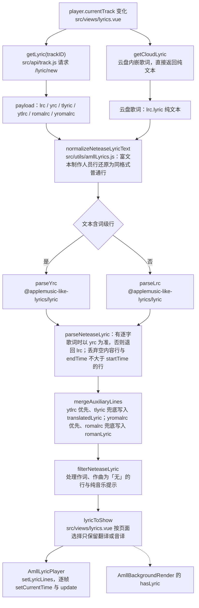

# AMLL 歌词整合

本文记录 YesPlayMusic 分支 `amll-lyrics-integration` 上这次歌词整合的范围、数据链路、组件接口、翻译合并规则、性能数据、构建方式与已知限制。文中引用的文件都以该分支的工作树为准。

## 目标与范围

这次整合把歌词页的歌词渲染换成 Apple Music-like Lyrics（以下称 AMLL），并调整歌词数据的取得与解析链路。范围包含四部分：

- 播放器：歌词行的渲染、逐字擦除、弹簧动画、间奏圆点、行间过渡、歌词行的点击与右键事件
- 背景：歌词页的流动渐变背景，由专辑封面生成
- 歌词数据链路：`/lyric/new` 接口的请求、制作人员富文本行的规范化、逐字歌词与普通歌词的解析、翻译与音译的合并
- 设置项：歌词字号、歌词行的垂直锚点位置、弹簧动画、非当前行的模糊与缩放、已播放行的隐藏、逐字渐变宽度、歌词背景类型、背景帧率、背景渲染比例

范围之外的内容：播放内核、音频解码、播放控制、歌单与搜索。AMLL core 的源码放在 `vendor/applemusic-like-lyrics` 子模块里，用途是查阅源码与本地构建 core，运行时不引用它；运行时依赖 npm 上的 `@applemusic-like-lyrics/core@0.6.0` 与 `@applemusic-like-lyrics/lyric@1.1.0`，以及七个 `@pixi/*` 包（AMLL core 把它们声明为 peer），`postcss-nesting` 在 devDependencies。

## 数据链路



链路细节：

- 曲目切换时 `src/views/lyrics.vue` 的 `currentTrack` watcher 调用 `getLyric()`，先清空上一首的歌词，再用请求序号丢弃过期响应，避免慢请求覆盖新曲目的歌词。
- 普通歌曲走 `src/api/track.js` 的 `getLyric`，请求 `/lyric/new`；不再使用 `/lyric`。路由注册在 `src/ncmModDef.js`，`/lyric/new` 必须排在 `/lyric` 之前，Express 的 `app.use` 按注册顺序做前缀匹配，排在后面会被 `/lyric` 先接走，逐字歌词就拿不到。
- `/lyric/new` 后端对应 `/api/song/lyric/v1`，带逐字歌词的响应含 `lrc/klyric/tlyric/romalrc/yrc/ytlrc`，不带逐字歌词时只有 `lrc/klyric/tlyric/romalrc`，`lrc` 字段始终存在。
- 云盘歌曲的内嵌歌词走 `getCloudLyric`，接口返回的是纯文本，构造为 `{ lrc: { lyric } }` 交给同一套解析函数。
- `normalizeNeteaseLyricText` 把 `/lyric/new` 里的裸 JSON 富文本行（形如 `{"t":开始毫秒,"c":[{"tx":"文本","li":"链接"},...]}`）还原成与所在文本同格式的普通行。制作人员行集中在歌曲开头与结尾，时长只由紧随其后的下一条富文本行决定，之后没有富文本行时沿用上一条已算出的时长；让时长延伸到下一句歌词的开始会把整段前奏并进这一行，前奏的间奏区间随之消失。
- `parseLyricText` 按行首格式选择解析器：文本里出现 `[开始时间,时长](开始时间,时长,保留)` 这种词级时间戳时交给 `parseYrc`，其余 LRC 家族的格式交给 `parseLrc`。网易云音乐历史上把毫秒分隔符写成冒号（`[00:20:97]` 表示 20.970 秒），解析前的正则同时接受 `[mm:ss]`、`[mm:ss.xx]`、`[mm:ss.xxx]` 与 `[mm:ss:xx]` 四种写法。
- `src/views/lyrics.vue` 的 `lyricToShow` 按页面上选择的类型生成新的歌词行对象，只保留翻译或音译其中一种；AMLL 要求歌词行传入后不得再修改。

## 组件职责

### src/components/AmllLyricPlayer.vue

AMLL 歌词播放组件在 Vue 2 下的封装。AMLL 的歌词组件本身与框架无关，只暴露一个宿主元素和一组命令式接口，官方的 Vue 绑定只支持 Vue 3，因此这里直接封装核心组件。

输入：

| 属性 | 类型 | 说明 |
| --- | --- | --- |
| `lines` | Array | AMLL 歌词行数组，时间单位为毫秒，必填 |
| `timeSource` | Function | 返回当前播放进度（毫秒）的函数，必填 |
| `playing` | Boolean | 是否正在播放，默认 `false` |
| `disabled` | Boolean | 是否停用，停用后不再逐帧更新动画，默认 `false` |
| `alignAnchor` | String | 目标歌词行的垂直锚点方式，默认 `center` |
| `alignPosition` | Number | 目标歌词行在组件高度上的位置比例，默认 `0.5` |
| `enableSpring` | Boolean | 是否启用弹簧动画，默认 `true` |
| `enableBlur` | Boolean | 是否模糊非当前歌词行，默认 `true` |
| `enableScale` | Boolean | 是否缩放非当前歌词行，默认 `true` |
| `hidePassedLines` | Boolean | 是否隐藏已经播放过的歌词行，默认 `false` |
| `wordFadeWidth` | Number | 逐字动画的渐变宽度，以歌词字号为倍数，默认 `0.5` |
| `fontSize` | Number | 歌词字号（像素），为 `0` 时使用 AMLL 默认字号 |

输出：

- 事件 `line-click`、`line-dblclick`（由同一次点击的 `event.detail` 区分）携带 `{ lineIndex, line }`
- 事件 `line-contextmenu` 携带 `{ lineIndex, line, nativeEvent }`，宿主通过 `preventDefault` 关闭浏览器默认菜单
- 宿主元素内部由 AMLL 播放器实例自行管理 DOM

用到的 AMLL 接口：`LyricPlayer` 构造、`getElement`、`setLyricLines`、`setCurrentTime`、`update(delta)`、`resume` / `pause`、`rebuildLyricView`、`onResize`、`setAlignAnchor`、`setAlignPosition`、`setEnableSpring`、`setEnableBlur`、`setEnableScale`、`setHidePassedLines`、`setWordFadeWidth`、`interludeDots.clearInterlude`、`calcLayout`，以及 `line-click`、`line-contextmenu` 两个事件。

播放进度不走响应式数据：AMLL 需要逐帧拿到高精度的进度，让父组件每帧更新数据会带动整个视图重新渲染，因此由本组件持有一个 `requestAnimationFrame` 循环，每帧调用 `timeSource` 取得进度。播放器实例、帧编号、逐帧标量都放在 `created` 里的实例字段上，不放进 `data`；Vue 2 会把 `data` 里的对象整棵遍历并建立 Observer，类实例会被判定为可观察对象，逐帧写入会多走一层响应式 setter。

### src/components/AmllBackgroundRender.vue

AMLL 动态背景组件，用专辑封面渲染流动渐变。

输入：

| 属性 | 类型 | 说明 |
| --- | --- | --- |
| `album` | String | 专辑封面链接 |
| `playing` | Boolean | 是否正在播放且歌词页可见，由调用方合成 |
| `hasLyric` | Boolean | 当前歌曲是否有歌词，渲染器据此调整动态效果 |
| `fps` | Number | 背景动画帧率，默认 `30` |
| `renderScale` | Number | 渲染比例，默认 `0.5` |

输出：宿主元素下由渲染器插入的画布。用到的 AMLL 接口：`BackgroundRender.new(MeshGradientRenderer)`、`getElement`、`setAlbum`、`setFPS`、`setRenderScale`、`setHasLyric`、`resume`、`pause`、`dispose`。

背景渲染器自带动画循环，不需要逐帧驱动，只在播放状态变化时同步暂停与恢复。`playing` 传入的是播放状态与歌词页可见性的合成结果，画布被隐藏时停止帧循环，避免无谓的 GPU 提交；重新显示时 `resume()` 会立即请求下一帧。子类的 `setAlbum` 会吞掉封面拉取与解码失败并打印错误，但拿不到 2D 上下文或者图片尺寸为 0 时仍会抛出，`applyAlbum` 把异常继续向上传递给调用方。

### src/utils/amllLyrics.js

| 导出 | 输入 | 输出 |
| --- | --- | --- |
| `normalizeNeteaseLyricText(text)` | 接口返回的歌词文本 | 规范化后的纯 LRC 或纯 YRC 文本 |
| `parseNeteaseLyric(payload)` | `/lyric/new` 的返回值，或 `{ lrc: { lyric } }` | AMLL 歌词行数组 `LyricLine[]` |
| `getLyricLineContent(line)` | 一条歌词行 | 该行的纯文本内容 |
| `filterNeteaseLyric(lines, artistName)` | 歌词行与歌手名称 | 过滤后的歌词行 |

`parseNeteaseLyric` 的处理顺序：优先解析 `yrc`，没有可用行时退回 `lrc`；丢弃内容为空与 `endTime <= startTime` 的行，逐字歌词会把开头的制作人员名单压缩成零时长的行，这类行没有可以显示的时间；把翻译与音译合并进主歌词行。`filterNeteaseLyric` 沿用 YesPlayMusic 原有的制作人员名单规则：去掉内容为「无」的作词、作曲行；当歌词很短且带有「纯音乐，请欣赏」提示时，再去掉与歌手同名的作词、作曲行，此时如果只剩下纯音乐提示，则视为没有歌词。

## 翻译字段与合并规则

`/lyric/new` 的逐字翻译字段是 `ytlrc`，普通翻译字段是 `tlyric`；逐字音译是 `yromalrc`，普通音译是 `romalrc`。此前的代码读的是 `ytlyric`，该键在接口响应里不存在，1694 首语料中 0 首带这个字段，于是逐字歌词曲目上 71.5% 的翻译行被丢弃。当前实现按 `payload?.ytlrc?.lyric || payload?.tlyric?.lyric` 取翻译，音译同理按 `yromalrc` 优先、`romalrc` 兜底。

翻译、音译与主歌词来自接口的不同字段，两边的开始时间只在部分行上完全相等。`mergeAuxiliaryLines` 按时间顺序为每条主歌词行挑选窗口内时间最接近的辅助行，规则如下：

- 容差窗口取该主歌词行时长的一半与 500ms 中较小的值。500ms 的依据是语料里辅助行与主歌词行开始时间不等时，时间差的中位数为 244ms、p75 为 470ms、p90 为 810ms，取 500ms 作为上限既能配上绝大多数同一句歌词，又不会够到相邻的一句；同时不得超过行长的一半，否则一句短歌词会越过自己的结束时间去取下一句的翻译。
- 主歌词行与辅助行各自按开始时间升序处理，辅助行用一个单调推进的游标扫描，落在「主歌词开始时间减去 500ms」之前的辅助行不会再被任何更晚的主歌词行用到，可以直接跳过。
- 一条辅助行只能写入一条主歌词行，写入后从候选里移除；同一时间可能出现多行歌词（例如开头的制作人员名单），距离相同时保留先出现的那条。
- 写入主歌词行的字段是 `translatedLyric` 与 `romanLyric`，AMLL 播放器据此显示翻译与音译。

1694 首语料上的复核结果：

| 指标 | 改动前 | 改动后 |
| --- | --- | --- |
| 未写入翻译的主歌词行 | 31027 | 8 |
| 完全没有翻译的曲目 | 587 | 0 |
| 主歌词行总数 | 不变 | 不变 |

具体到曲目 `Complicated`，94 行歌词里改动前写入 0 行翻译，改动后写入 92 行。

## 性能

测量环境是打包版 Electron 13，采样窗口 8 秒。

| 指标 | 改动前 | 改动后 |
| --- | --- | --- |
| 逐字歌词帧率 | 55.9 帧/秒 | 60 帧/秒 |
| 逐字歌词掉帧 | 34 | 0 |
| 逐字歌词样式重算耗时 | 1.19s | 0.345s |
| 逐字歌词任务耗时 | 2.84s | 1.10s |
| 普通歌词样式重算耗时 | 0.92s | 0.094s |

### 播放进度变量的写入节流

Chromium 91 不支持无前缀 `mask-image`，AMLL 因此退回 `CalcMaskAnimator` 的计算遮罩路径：词元素的 `mask-position` 写成依赖 `--amll-player-time` 的 `calc` 表达式，播放器每帧往根元素上写这个变量。它没有注册为自定义属性，值一变整棵歌词子树都要重新计算样式；普通歌词没有任何元素消费它，这笔开销纯粹是浪费。

`installPlayerTimeWrite` 接管播放器根元素 `style` 上的 `setProperty`，只拦截这一个属性：普通歌词整帧跳过写入，逐字歌词每两帧写一次（`PLAYER_TIME_WRITE_INTERVAL = 2`）。隔一帧写一次同样能看出擦除在推进，开销降回普通歌词的水平。是否属于逐字歌词由 `hasWordLevelLines` 在这批歌词行换入时算一次并缓存：普通歌词每行只解析出一个音节，音节时间与整行时间完全一致；某个音节时间与所在行不一致，或者一行里拆出多个音节，就按逐字歌词处理。

更彻底的做法是把变量写到实际消费它的词元素上，这样每次写入的失效范围只有那个元素；这属于上游改动，需要在 AMLL core 里调整动画器与样式。

### 暂停时仍然逐帧调用 update()

暂停期间媒体时钟不动，进度没有变化时不再调用 `setCurrentTime`，但 `update(delta)` 仍然逐帧执行。滚动、窗口尺寸变化引起的排版只在 `update → commitChanges → renderStyles` 这条链路上写进 DOM，跳过它会让歌词列表不再响应拖动，也会漏掉尺寸变化后的重新排版。

### 其余逐帧开销的处理

- 暂停间奏的重算去重：暂停时处在某段间奏里，间奏演出会被锚定在跳转那一刻，入场延迟要靠媒体时钟推进才能走完，而暂停时媒体时钟不动，圆点一直不可见。处理方式是把演出区间清掉后按正常播放的排版理由重算，锚点回到间奏起点。重算会让整棵子树重新排版，因此只在曲目、暂停时的进度与间奏区间组成的组合发生变化时做一次（`syncPausedInterlude` 用 `lineRevision|time|startTime|endTime` 作为键），恢复播放时清空记录。
- 入位保护的集合化：歌词行回到页面上时，位移要等这一帧的样式提交才会写入，这中间浏览器已经按没有位移的样子算过一次样式，关闭弹簧动画时用于补位的 `transition` 会把这次入位当成一次位移过渡，歌词从容器顶部滑到自己的位置，页面上方因此闪过一行歌词。保护窗口结束后只剩被写过内联过渡的元素需要收尾，用 `heldElements` 集合记住它们，遍历范围从全部歌词行降为常数级。
- 播放器实例与逐帧标量移出 `data`，避开 Vue 2 的响应式包装，见「组件职责」一节。

## 构建与环境

项目 `.nvmrc` 写的是 Node 14，devenv 使用 Node 16；当前机器是 Node 22，Terser 在 Node 17 以上需要 legacy provider，因此构建命令带上 `NODE_OPTIONS=--openssl-legacy-provider`。Electron 二进制从 `.dev/amll/electron-cache` 复用，避免联网下载：

```sh
NODE_OPTIONS=--openssl-legacy-provider \
ELECTRON_CACHE=<仓库根>/.dev/amll/electron-cache \
npx vue-cli-service electron:build -p never -m
```

产物为 `dist_electron/YesPlayMusic-mac-0.4.10-arm64.dmg`。macOS 上应用未签名，首次打开需要在 Finder 里右键选择「打开」。

`vendor/applemusic-like-lyrics` 是 git 子模块，指向 `https://github.com/amll-dev/applemusic-like-lyrics.git`，锁定提交 `86200dea`，比 npm 上的 `core-bundle@0.6.0` 多一个性能提交 `#619`。需要验证上游后续改动时，可以在子模块里构建 core，再把产物替换进 `node_modules`。

## 已知限制与上游对比

### 弹簧开关的作用范围（上游接口范围）

`setEnableSpring` 只控制歌词行的位移与缩放弹簧。逐字歌词的词级上浮（`float-word`）与强调往复（`sin` 曲线）没有开关，实测关闭弹簧后动画数量不变（151 个）。要让这两类动画也受设置控制，需要 AMLL core 暴露对应的接口。

### 播放进度变量的失效范围（宿主已节流，彻底解决属于上游）

Chromium 91 上逐字擦除走 `CalcMaskAnimator` 回退路径，由每帧的 `--amll-player-time` 驱动。该变量未注册为自定义属性，写入会引发整棵子树样式重算，宿主侧已经做了跳过与隔帧节流。把变量写到消费它的词元素上是更彻底的做法，需要在 AMLL core 的动画器与样式里改动。

### AMLL 0.6.0 的逐帧开销（上游后续提交已改）

AMLL 0.6.0 的 `commitChanges` 每帧对全部歌词组做一次 `indexOf`，复杂度为 O(n²)；视口外的行会被赋 `blur=5` 并跑一次 0.4 秒的模糊过渡；`calcLayout` 每帧读一次 `window.innerWidth`，触发强制样式解析。这些在上游后续提交里已经改掉，本地子模块包含这些改动，可以自行构建 core 验证。

### 隐藏状态下的测量（上游缺少测量保护）

歌词页隐藏时，如果 AMLL 对零尺寸元素做测量，会算出含 `NaN%` 的无效遮罩渐变。重新显示时本组件会重建视图恢复，属于上游的测量保护缺失。

### Chromium 91 的能力限制

- CSS 嵌套：AMLL 的 `style.css` 使用嵌套语法，构建时用 `postcss-nesting` 展开（`vue.config.js` 的 postcss 配置，指定插件会覆盖 vue-cli 默认配置，因此一并带上 `autoprefixer`）。
- `mix-blend-mode: plus-lighter` 与无前缀 `mask-image` 不支持：歌词层因此改用普通混合并跟随主题文字颜色（`AmllLyricPlayer.vue` 的样式覆盖），逐字擦除走计算遮罩回退。
- Media Queries Level 4 的区间语法不支持：AMLL 的 `style.css` 里有三处 `@media screen and (width <= 768px)` / `(width <= 500px)`，在 Chromium 91 上全部失效。这是上游产物的问题，记录为已知限制。

## 如何复现测量

测量与验证脚本放在 `tools/amll`：

| 脚本 | 用途 |
| --- | --- |
| `verify-translation-merge.mjs` | 用 `.dev/amll` 的语料复核翻译与音译的合并结果 |
| `verify-controlled-player-time.mjs` | 校验播放进度变量写入的接管与节流 |
| `verify-runtime-effects.js` | 校验逐字擦除仍在推进、暂停期间滚动仍会重绘 |
| `perf-metrics.js`、`perf-summarize.js` | 采集帧时间、长任务、DOM 样式写入与主线程计数，并压缩成一行便于对比 |
| `perf-ab.js` | 在真实播放中按补丁项做 A/B 测量，判断哪一项样式工作占据主线程 |
| `electron-probe-perf.js` | 启动带远程调试端口的 Electron 探测实例 |
| `cdp-eval.js` | 通过 CDP 在页面里执行表达式并打印结果 |
| `serve-netease-api.js`、`serve-embedded-api.js` | 启动本地接口服务，临时目录指向 `.dev/amll/netease-tmp` |
| `probe-animations.js`、`probe-lyric-dom.js`、`probe-mask-computed.js`、`probe-mask-nan.js`、`probe-mask-progress.js`、`probe-mask-usage.js` | 采集动画数量、歌词 DOM 与遮罩相关状态 |

语料与中间产物在 `.dev/amll`（被 `.gitignore` 排除的本机目录）：

| 路径 | 内容 |
| --- | --- |
| `.dev/amll/census-lyrics.json` | 1694 首 `/lyric/new` 的原始响应 |
| `.dev/amll/census-rows.json` | 逐首的字段长度、解析行数、过滤结果等汇总 |
| `.dev/amll/census-verify.json`、`.dev/amll/census-current-logic.json` | 复核结果 |
| `.dev/amll/reports` | 此前的分析报告 |
| `.dev/amll/electron-cache` | 离线打包用的 Electron 13.6.9 压缩包（darwin-arm64 与 darwin-x64 两份）与解压缓存 |
| `.dev/amll/netease-tmp` | 接口服务的临时目录 |

逐帧性能数据由打包版 Electron 13 配合远程调试采集，采样窗口 8 秒，用 `electron-probe-perf.js` 打开页面后由 `perf-metrics.js` 采集，再用 `perf-summarize.js` 汇总。
